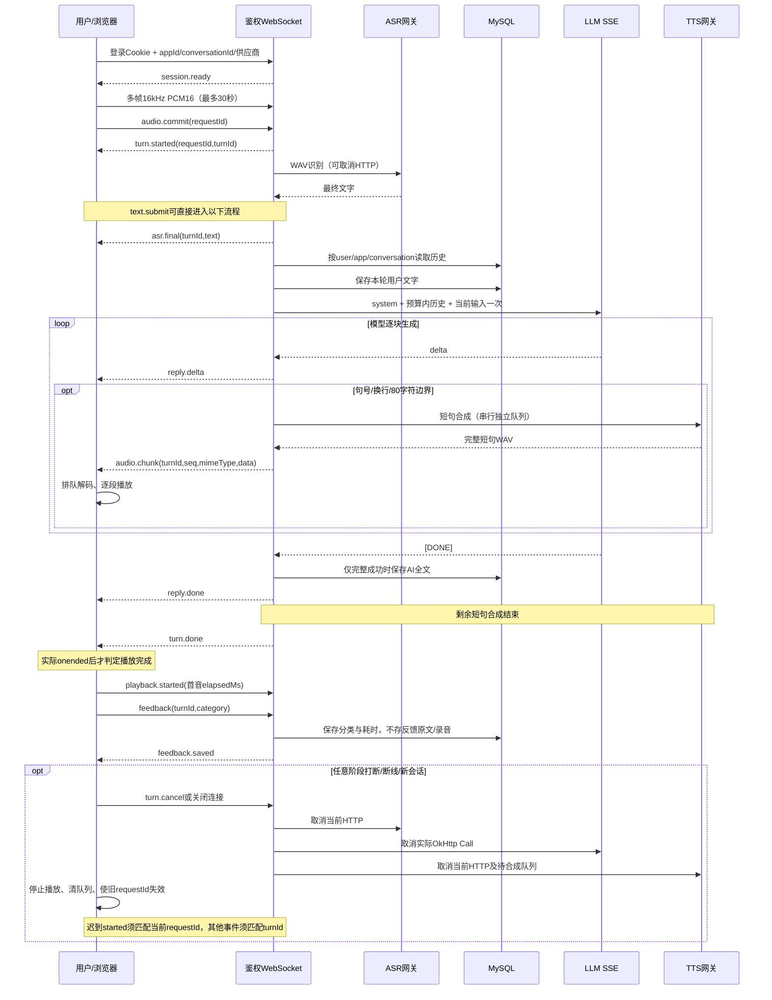

# 语音对话时序与反馈

本轮实现采用按轮发言：录音期间不播放角色声音，点击结束发言后提交，支持用户主动打断。不是自动VAD、全双工或原生实时语音模型。

文字流和语音合成是两条订阅，慢TTS不会拖住文字显示。TTS错误保留文字，模型错误/截断不保存半截AI消息；完整模型文字即使随后被用户打断播放，仍可能已经保存。当前不按用户实际听到的字数截断历史，答辩时应说明这个取舍。

反馈不止“好/不好”：当前按延迟、识别、相关性、角色、声音五类绑定具体轮次；前端收到保存确认才提示成功。首音时间由浏览器实际开始播放回调采集，经登录WS发送服务器日志。时间起点是文字提交或识别完成，不包含录音与ASR耗时；服务端elapsedMs是编排阶段时钟，不能与客户端时间直接混用。反馈表只有分类、用户/角色/会话/轮次、可选耗时与创建时间；不额外保存录音。

后续评测应使用明确授权的真人中文、噪声和口音样本，分别测CER/WER、回答相关性、角色一致性、打断成功率、首音P50/P95与失败率。当前没有数据集、质量看板或线上灰度实验结果，不把一次581ms首音观测说成稳定性能。供应商选择为手动配置，不做隐式付费回退。
